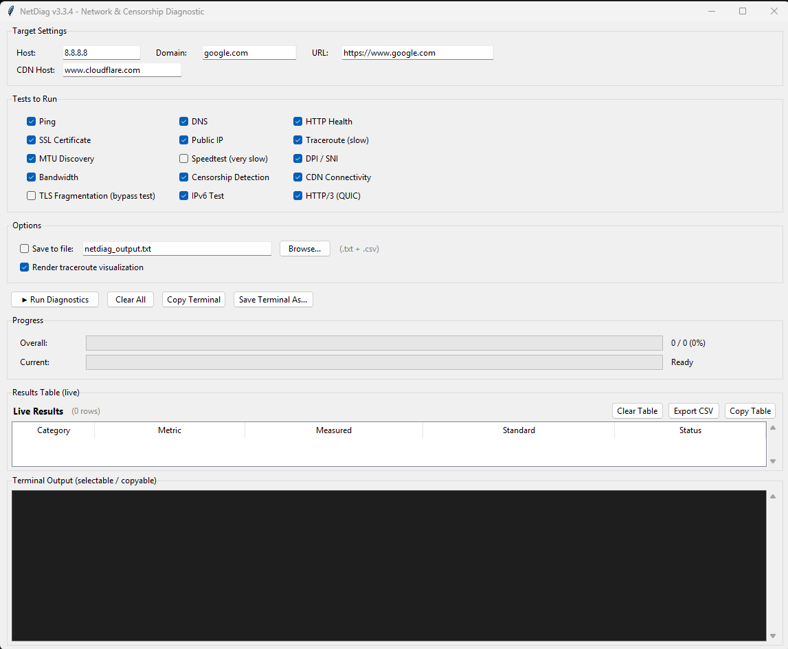

# NetDiag

A comprehensive cross-platform network & censorship diagnostic tool with GUI and CLI.


**Author:** Majid Mousavian Nezhadsadghi

---

## 📸 Screenshot



*NetDiag GUI showing live results table, dual progress bars, and terminal output.*

---

## ✨ Features

- **Connectivity**: Ping, DNS, HTTP, SSL, MTU, Bandwidth, Speedtest
- **Route analysis**: Traceroute with intelligent IP classification
  (LAN / CGNAT / ISP / DOM / INT / DST)
- **CDN detection**: Cloudflare, Akamai, Fastly, CloudFront
- **Censorship detection**: DNS interception, SNI-DPI, HTTP blocking,
  blockpage detection, and multi-mechanism classification
- **Advanced probes**: TLS fragmentation test (DPI bypass detection),
  IPv6 capability, HTTP/3 (QUIC) detection
- **GUI**: Live results table, dual progress bars, color-coded output,
  copy-to-clipboard, CSV export
- **CLI**: Automation-ready, JSON export, file output
- **Locale-agnostic**: works on English, Persian, and Arabic Windows

---

## 📦 Installation

### 1. Clone or download this repository

```bash
git clone https://github.com/YOUR_USERNAME/NetDiag.git
cd NetDiag
```

### 2. Install dependencies

```bash
pip install -r requirements.txt
```

> **Linux users**: install tkinter for GUI mode:
> ```bash
> sudo apt install python3-tk
> ```

### 3. Verify the installation

```bash
python netdiag.py --selftest
```

---

## 🚀 Usage

### GUI mode (default)

```bash
python netdiag.py
```

### CLI mode

```bash
# Full scan
python netdiag.py --cli

# Fast scan (skips slow tests)
python netdiag.py --cli --quick

# Include TLS fragmentation test
python netdiag.py --cli --tls-frag

# Only censorship analysis
python netdiag.py --cli --only-censorship

# Save report to file
python netdiag.py --cli --output report.txt
```

### All CLI options

```bash
python netdiag.py --help
```

---

## 🔬 TLS Fragmentation Test (`--tls-frag`)

Many ISPs block access to websites by inspecting the **SNI field** in the
TLS ClientHello (a plaintext message during the handshake).

This test checks whether **splitting the ClientHello into small TCP fragments**
can bypass such DPI. Results:

| Verdict | Meaning | Action |
| :--- | :--- | :--- |
| `FRAGMENTATION_BYPASS_WORKS` | DPI does not reassemble TCP fragments | [GoodbyeDPI](https://github.com/ValdikSS/GoodbyeDPI) can bypass |
| `DPI_REASSEMBLES_FRAGMENTS` | DPI reassembles TCP | Only VPN/proxy works |
| `NO_BYPASS_NEEDED` | Targets are already accessible | No action needed |

Example:

```bash
python netdiag.py --cli --tls-frag --only-censorship
```

---

## 📊 Sample Output

```
+-----------+-------------------------------+------------------+------------------------------+
|  Category |             Metric            |     Standard     |            Status            |
+-----------+-------------------------------+------------------+------------------------------+
| Network   | Ping Latency                  | <= 100 ms        | [OK] GOOD                    |
| Network   | MTU Size                      | 1492 (PPPoE)     | [OK] OK                      |
| Filtering | DNS Resolvers                 | CONSISTENT       | [XX] DNS_INTERCEPTION        |
| Filtering | SNI: blocked_sni              | ?                | [!!] TCP_RESET               |
| Filtering | TLS Fragmentation             | DPI not frag...  | [OK] BYPASS                  |
+-----------+-------------------------------+------------------+------------------------------+
```

---

## 🧪 Requirements

- **Python 3.8+**
- **tkinter** (bundled with Python on Windows/macOS)
- Third-party packages listed in [`requirements.txt`](requirements.txt)

Optional dependencies (Scapy, pyOpenSSL) enhance fallback reliability.
If they are missing, NetDiag gracefully falls back to stdlib methods.

---

## 🗂️ Project Structure

```
NetDiag/
├── netdiag.py            # Main application (GUI + CLI)
├── Screenshot.png        # GUI screenshot used in this README
├── requirements.txt      # Python dependencies
├── LICENSE               # MIT license
├── README.md             # This file
└── .gitignore            # Files ignored by Git
```

---

## 📝 Changelog

### v3.3.4 (current)
- Fixed speedtest freeze on timeout (daemon thread + join)
- Thread-safe GUI (Tkinter variables snapshotted in main thread)
- Fixed double-execution in `DiagnosticModule.execute`
- Centralized socket cleanup (IPv6, QUIC, TLS frag)
- Robust SSL expiry parsing (`ssl.cert_time_to_seconds`)
- Safe subprocess arguments (no `shell=True` with f-strings)
- **Locale-agnostic MTU discovery** — now works on Persian/Arabic Windows
- Improved HTTP health check (User-Agent header)
- Fixed blockpage "www." prefix stripping

### v3.3.3
- Added IPv6 diagnostic module
- Added HTTP/3 (QUIC) detection
- Enhanced TLS fragmentation test
- Removed GeoIP (privacy + speed)

### v3.3.2
- Fixed CGNAT/ISP hop classification
- Added blockpage HTTP/HTTPS comparison

### v3.3.1
- Initial public beta

---

## 🤝 Contributing

Contributions are welcome. Please:

1. Fork the repository
2. Create a feature branch (`git checkout -b feature/my-feature`)
3. Commit your changes (`git commit -m "Add my feature"`)
4. Push to the branch (`git push origin feature/my-feature`)
5. Open a Pull Request

Please keep the code style consistent with the existing modules.

---

## 📜 License

This project is licensed under the **MIT License** — see [LICENSE](LICENSE)
for details.

You are free to use, modify, and distribute this software for any purpose,
including commercial use, as long as the original copyright notice is
preserved.

---

## ⚠️ Disclaimer

This tool is intended for **network diagnostics and research purposes only**.

- Use it only on networks you own or have explicit permission to test.
- Do not use it to attack, disrupt, or bypass protections on networks
  you do not own.
- The author is not responsible for any misuse.

---

## 🙏 Acknowledgements

- [ping3](https://github.com/kyan001/ping3) — ICMP ping implementation
- [dnspython](https://www.dnspython.org/) — DNS toolkit
- [icmplib](https://github.com/jbourbeau/icmplib) — Traceroute library
- [speedtest-cli](https://github.com/sivel/speedtest-cli) — Ookla speedtest
- [GoodbyeDPI](https://github.com/ValdikSS/GoodbyeDPI) — DPI bypass research

---

**Made with ❤️ by Majid Mousavian Nezhadsadghi**